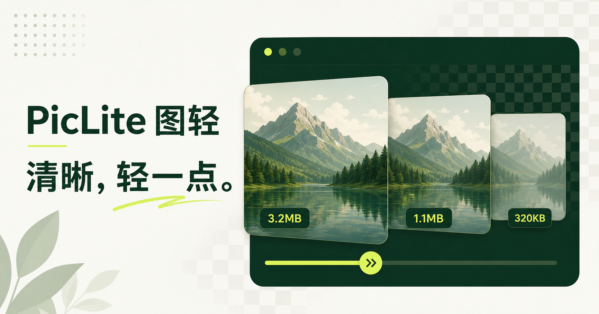

## 项目概述

写公众号、做 PPT、运营博客、整理素材，几乎所有人都会遇到图片难题：原图体积巨大，上传卡顿；用在线压缩工具，图片要上传第三方服务器，隐私存隐患；压缩完画质糊掉，反复调参数全靠盲猜；想要私有图床，部署又过于复杂。

PicLite 正是为解决这一痛点而生的开源工具。它同时兼顾 **本地图片压缩** 与 **自托管私有图床** 两大能力，全平台免费开源，无广告无会员，解决图片处理全链路痛点。

PicLite 的核心亮点在于：图片全部在本机完成运算，默认不上传任何外网服务器，浏览器网页版、桌面客户端均是如此，断网也能正常压缩图片。只有你主动开启图床上传功能，图片才会推送至你自己部署的服务，隐私可控，企业、个人都可以放心使用。



## 桌面端：强大的本地压缩工作台

### 连续画质滑动调节，实时预估文件大小

区别普通工具的几档固定画质，PicLite 提供连续画质滑动条（1‑100%），拖动滑块就实时预览压缩后的预估体积，直接拿捏 “画质够用，体积最小” 的平衡点，不用反复导出测试。

### 丰富格式支持

支持 JPG、PNG、WebP、GIF，支持 GIF 动图压缩，格式互转，清除图片元数据，添加文字水印。

### 批量处理

- 批量导入图片
- 文件夹监控
- 复制粘贴直接导入
- 一键批量导出
- 自带智能防增大逻辑：压缩后体积变大时会自动保留原图，避免越压越大

### 实时对比预览

原图、压缩结果双视图，可放大 1:1 查看像素，肉眼确认画质损失，再导出文件。不管是公众号配图、PPT 素材、网页素材，还是敏感截图，都可以在本地完成瘦身。

### 桌面交互特色

- 可通过全局快捷键、复制图片、拖放文件或“选择本地图片”唤出悬浮窗
- 悬浮窗支持复制、预览、撤销、继续缩小、切换格式、加水印或上传图床
- 支持拖动和缩放、堆叠循环与展开布局、数量上限和自动隐藏
- 可在设置中自由选择最多 6 个操作按钮

## 进阶玩法：Docker 一键部署私有图床

PicLite 不只是压缩软件，还可以部署成私有图床服务，适合博主、开发者、内网团队使用。

### 部署优势

- **无数据库设计**：全部数据存储在文件目录，部署简单，迁移方便
- **Lite 轻量模式**：适合新手，图片上传获取永久直链，API 密钥管理，图片删除，无需复杂配置
- **Classic 经典模式**：解锁水印、远程下载、访问统计等完整能力
- **可对接存储**：支持 MinIO、S3 等对象存储

### Docker 一行命令即可拉起服务

```bash
docker pull ghcr.io/amiaoapp/piclite:latest
docker run -d \
  --name piclite \
  -p 3456:3456 \
  --restart unless-stopped \
  ghcr.io/amiaoapp/piclite:latest
```

浏览器打开 `http://服务器IP:3456` 即可访问。

### 高级配置

如需修改监听地址、宿主机端口或版本，可在项目目录创建 `.env` 文件：

```env
PICLITE_BIND=0.0.0.0
PICLITE_PORT=3456
PICLITE_TAG=1.5.0
```

## 和 TinyPNG 怎么选？

| 工具    | 处理方式       | 网络依赖 | 特点                                       |
| ------- | -------------- | -------- | ------------------------------------------ |
| TinyPNG | 云端服务器压缩 | 需要联网 | 压缩算法成熟，图片上传外网，免费有数量限制 |
| PicLite | 本地设备运算   | 可离线   | 图片不出本机，无次数限制，还可自建私有图床 |

**简单总结**：

- 普通公开素材：TinyPNG 够用
- 在意隐私、需要离线批量处理、想要自己的图床：优先 PicLite

## 技术栈

PicLite 基于现代技术栈构建，确保了高性能与跨平台兼容性：

| 层次       | 技术选型                                      |
| ---------- | --------------------------------------------- |
| 桌面端     | Tauri 2 + Rust                                |
| 图片处理   | 本地运算（无需上传服务器）                    |
| 图床服务   | GitHub Container Registry（GHCR） Docker 镜像 |
| 许可证     | GPL-3.0-or-later                              |
| 受灵感来源 | FuzzyIdeas/Clop（桌面自动化工作流借鉴）       |

桌面端使用 Tauri 2 框架，相比 Electron 更轻量，启动速度快，资源占用低。图片压缩全部在本机完成，确保数据不出设备。

## 快速上手

### 获取方式

访问 GitHub Releases 下载对应系统的安装包：

- **Windows x64 / ARM64**：`.exe` 或 `.msi`
- **macOS Apple Silicon / Intel**：`.dmg`
- **Linux x64 / ARM64**：`.AppImage` 或 `.deb`

> macOS 构建目前为 ad-hoc 签名，首次运行可能需要在“系统设置 → 隐私与安全性”中允许打开。

### 一键启动（桌面端）

下载安装包后直接打开即可使用，无需额外配置。首次启动时会自动检测环境。

### 部署私有图床（Docker 版）

1. 拉取镜像：`docker pull ghcr.io/amiaoapp/piclite:latest`
2. 运行容器：`docker run -d --name piclite -p 3456:3456 --restart unless-stopped ghcr.io/amiaoapp/piclite:latest`
3. 访问服务：浏览器打开 `http://你的服务器IP:3456`

### Web 演示版

想要快速体验而不想安装？可使用 GitHub Pages 在线 Demo：  
👉 https://amiaoapp.github.io/PicLite/  
（注意：在线 Demo 为静态版本，图片直接在浏览器本地处理，不提供系统托盘、全局快捷键和持续文件夹监测等系统级功能）

## 常见问题

**Q：图片真的不会上传到服务器吗？**  
A：是的。除非你主动开启图床上传功能并配置了自己的服务，否则图片全部在本机完成处理，不会上传到任何外网服务器。

**Q：支持哪些图片格式？**  
A：支持 JPG、PNG、WebP、GIF 的导入、转换、压缩与等比例缩放。GIF 动图同样支持压缩。

**Q：怎么避免压缩后图片越压越大？**  
A：PicLite 内置智能防增大逻辑。当检测到压缩后体积变大时，会自动保留原图，确保不会出现越压越大的情况。

**Q：私有图床支持哪些存储后端？**  
A：支持 WebDAV、S3/R2、OSS、FTP、SFTP 等多种协议，可对接 MinIO、云存储等。

**Q：桌面端和网页版有什么区别？**  
A：桌面端提供系统托盘、全局快捷键、剪贴板监听、文件夹监测等系统级功能；网页版为静态演示版，仅提供基础压缩功能。

**Q：如何升级到最新版本？**  
A：桌面端会自动检查更新；Docker 版可执行 `docker compose pull` 后 `docker compose up -d` 完成升级。

## 使用建议

### 隐私敏感场景

- 身份证、银行卡、内部文档截图等敏感图片：**务必保持默认设置（不开启图床）**，确保图片永不离开本机
- 公众号配图、PPT 素材：**可根据需要开启图床功能**，上传至自己的私有服务器

### 工作流程推荐

1. **日常压缩**：使用桌面端进行批量图片处理，调节画质滑块获取最优体积
2. **敏感图片**：保持离线模式，仅在本地处理
3. **团队协作**：部署私有图床 Docker 服务，团队成员通过内网访问统一图床
4. **自动化**：结合文件夹监控功能，实现下载文件夹自动压缩归档

---

> **引用信息**
>
> - 原文标题：开源神器 PicLite｜图片不上传服务器！本地压缩 + 自建图床，免费无广告
> - 原文链接：https://mp.weixin.qq.com/s/OEFf8HERvqDFZ8tOhm5N6Q
> - 原文作者：笑颜工具箱
> - 公众号名称：笑颜工具箱
> - GitHub 地址：https://github.com/amiaoapp/piclite
> - 在线演示：https://amiaoapp.github.io/PicLite/
> - 许可证：GPL-3.0-or-later
