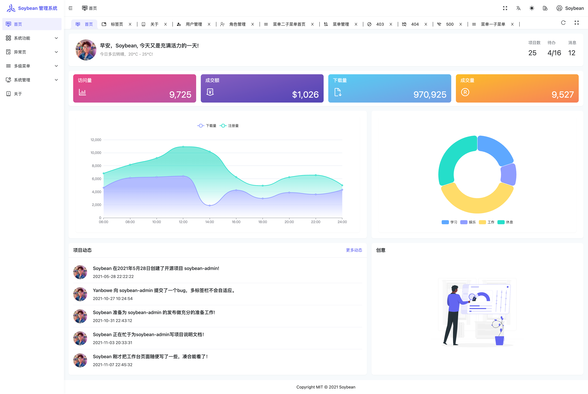

## 项目概述

SoybeanAdmin 是一个清新优雅、高颜值且功能强大的后台管理模板，由 SoybeanJS 团队开发和维护。项目基于当前最流行的前端技术栈构建，包括 Vue3、Vite、TypeScript、Pinia 和 UnoCSS。它内置了丰富的主题配置和组件，代码规范严谨，实现了自动化的文件路由系统。SoybeanAdmin 为开发者提供了一站式后台管理解决方案，开箱即用，同时也是学习前沿技术的优秀实践项目。

目前项目在 GitHub 已获得 26k+ Star，拥有活跃的开源社区和完整的周边生态体系。



## 技术栈与架构

### 核心技术

SoybeanAdmin 采用了当前社区最热门的前端技术栈：

- **Vue 3.4+**：使用最新的 Vue3 语法特性，支持 Composition API 和 `<script setup>` 写法
- **Vite 8**：下一代前端构建工具，提供毫秒级热更新和极速的开发体验
- **TypeScript**：支持严格的类型检查，大幅提升代码可维护性和开发体验
- **Pinia**：新一代 Vue 状态管理库，简洁且支持完整的 TypeScript 类型推导
- **NaiveUI**：基于 Vue3 的组件库，提供精美一致的 UI 组件
- **UnoCSS**：即时的原子化 CSS 引擎，支持按需生成样式，极大减小 bundle 体积

### 项目架构

项目采用 pnpm monorepo 架构设计，将代码库按照功能模块划分到不同的包（packages）中。这种架构模式使得项目结构清晰、各模块职责明确，便于维护和扩展。同时 monorepo 模式也便于管理内部依赖和版本一致性。

### 代码规范

项目严格遵循 SoybeanJS 规范，集成了以下代码质量工具：

- **ESLint**：代码静态检查
- **Prettier**：代码格式化
- **simple-git-hooks**：Git 钩子自动触发检查

所有代码在提交前都会经过自动检查，确保代码风格统一、语法规范。

## 核心特性

### 1. 自动化文件路由系统

SoybeanAdmin 实现了智能的自动化文件路由系统，通过 Elegant Router 插件，可以根据项目文件结构自动生成路由配置、导入声明和类型定义。开发者只需创建文件，无需手动配置路由，大幅提升开发效率。

### 2. 灵活的权限路由

项目同时支持两种权限路由模式：

- **前端静态路由**：路由配置在代码中预先定义，适合权限相对固定的场景
- **后端动态路由**：权限由后端接口返回，适合需要灵活控制权限的场景

开发者可根据实际需求选择合适的权限方案，或者将两者结合使用。

### 3. 丰富的主题配置

内置多样化的主题配置选项，包括：

- 主题颜色自定义
- 深色/浅色模式切换
- 侧边栏样式配置
- 组件样式定制

UnoCSS 的集成使得主题切换更加灵活，可以轻松实现品牌定制和样式微调。

### 4. 内置国际化方案

项目完整集成了国际化（i18n）功能，开箱即用。支持多语言切换，可以快速适配全球化的产品需求。

### 5. 丰富的页面组件

内置多种实用页面和组件：

- 错误页面：403（无权限）、404（页面不存在）、500（服务器错误）
- 布局组件：可配置的侧边栏、顶栏、标签页
- 功能组件：主题配置面板、快捷入口等

### 6. 命令行工具

提供高效的命令行工具，支持：

- 自动生成符合 Conventional Commits 规范的提交信息（`pnpm commit`）
- 一键删除文件并清理相关引用
- 自动化发布流程

### 7. 移动端适配

完美支持移动端访问，通过响应式布局设计，在手机、平板等移动设备上也能获得良好的使用体验。

### 8. 多框架版本支持

SoybeanAdmin 不仅有 Vue3 版本，还提供了多个框架的适配版本：

| 版本              | 组件库         | 预览地址                    |
| ----------------- | -------------- | --------------------------- |
| NaiveUI 版本      | NaiveUI        | https://naive.soybeanjs.cn/ |
| ElementPlus 版本  | ElementPlus    | https://elp.soybeanjs.cn/   |
| AntDesignVue 版本 | Ant Design Vue | https://antd.soybeanjs.cn/  |

开发者可根据团队技术栈自由选择合适的版本。

## 快速开始

### 环境要求

在开始之前，请确保开发环境满足以下要求：

- **Git**：用于克隆和管理项目版本
- **Node.js**：>= 20.19.0，推荐使用 20.19.0 或更高版本
- **pnpm**：>= 10.5.0，推荐使用 10.5.0 或更高版本

> 由于项目采用 pnpm monorepo 管理方式，请务必使用 pnpm 安装依赖，不要使用 npm 或 yarn。

### 克隆项目

```bash
# 从 GitHub 克隆
git clone https://github.com/soybeanjs/soybean-admin.git

# 或从 Gitee 克隆（国内访问更快）
git clone https://gitee.com/honghuangdc/soybean-admin.git
```

### 安装与启动

```bash
# 进入项目目录
cd soybean-admin

# 安装依赖
pnpm install

# 启动开发服务器
pnpm dev
```

### 构建生产版本

```bash
# 构建生产环境版本
pnpm build
```

## 社区与生态

### 活跃的开源社区

SoybeanAdmin 拥有活跃的开源社区，开发者可以通过以下方式参与：

- **GitHub Issues**：提交问题和建议
- **GitHub Pull Requests**：贡献代码
- **飞书交流群**：与社区成员实时交流

### 丰富的周边生态

围绕 SoybeanAdmin 形成了丰富的周边生态，包括：

- **skyroc-admin**：SoybeanAdmin 的 React 实现版本
- **electron-mock-admin**：Mock API 管理系统
- **pea**：基于 SpringBoot 的后端权限系统
- **FastSoyAdmin**：基于 FastAPI + Vue3 的 Python 版本

更多周边项目可在官方文档的「周边生态」页面查看。

### 贡献指南

项目热烈欢迎各种形式的贡献。贡献代码时请使用内置的 `pnpm commit` 命令生成符合规范的提交信息。在提交 Pull Request 前，请确保代码已通过所有检查。

## 开源协议

SoybeanAdmin 基于 MIT 开源协议开放源代码，完全免费使用。需要注意的是，项目仅供学习参考，商业使用请保留作者版权信息。

## 总结

作为一款成熟的后台管理模板，SoybeanAdmin 集成了当前前端社区最热门的技术栈，以其清新优雅的界面设计、丰富的功能特性、完善的代码规范和活跃的社区支持，成为了众多开发者构建后台管理系统的首选方案。

无论是需要快速搭建后台系统的企业项目，还是学习 Vue3 全家桶技术的学习者，SoybeanAdmin 都是一个值得关注的优秀开源项目。

---

> **引用信息**
>
> - GitHub 地址：https://github.com/soybeanjs/soybean-admin
> - 官方文档：https://docs.soybeanjs.cn/
