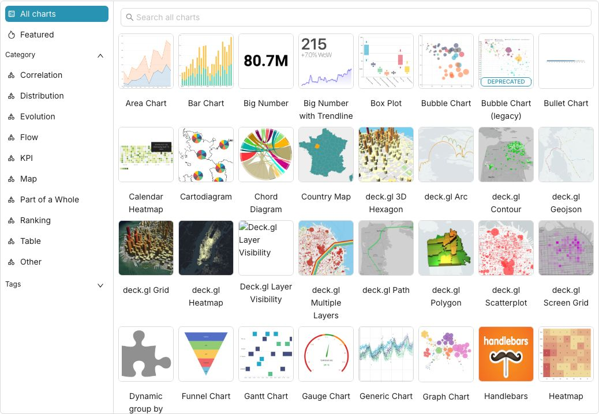

## 项目概述

企业里自建数据可视化平台这件事，曾经是 Tableau 或 PowerBI 的地盘，买授权、部 License Server、等 IT 审批，走一圈下来往往好几个月。Apache Superset 是另一条路：完全开源、Apache 基金会项目、自托管、支持从 PostgreSQL 到 BigQuery 再到 ClickHouse 的 70 多种数据源。



Superset 有两个主要入口。一是无代码的图表构建器：选数据源、选表、拖字段、配聚合方式，几分钟出一张图，不需要写 SQL。二是 SQL Lab，一个功能完整的浏览器内 SQL 编辑器，支持多标签查询、历史记录、结果导出，写完 SQL 直接把结果存成图表。两个入口面向不同背景的用户，但生成的图表都能放进同一个仪表板。

图表类型覆盖面很宽：折线图、柱状图、饼图、散点图、热力图、地理位置地图、日历热图……还有一个图表画廊可以直接浏览所有支持的类型。仪表板支持多图联动过滤，点击一个维度，其他图表联动刷新，这对做数据探索很有用。

权限系统是基于角色的，可以精细控制到"某个用户只能看哪几个仪表板"、"某个角色只能查哪几张表"。生产环境里配上 LDAP 或 OAuth2，权限管理就不需要另建一套了。

最快跑起来的方式是 Docker Compose：

```bash
git clone https://github.com/apache/superset.git
cd superset
docker compose -f docker-compose-image-tag.yml up
```

等镜像拉完启动后，浏览器打开本机 8088 端口就能进管理界面，默认账号 admin/admin。生产环境建议用官方 Helm chart 部署到 Kubernetes，配置外部 PostgreSQL 和 Redis 做状态存储和缓存。

Superset 的定位是"分析师和数据团队用的 BI 工具"，它的优势在于 SQL 能力强、数据库兼容性广、自托管成本低。不太适合完全非技术背景的业务用户直接上手——毕竟建连接、配 SQL、理解数据模型还是需要一定门槛。但如果团队里有数据工程师或分析师，Superset 基本上能覆盖日常的数据看板和探索需求，而且不用付 Tableau 的那笔钱。

项目地址：https://github.com/apache/superset

## 核心特性

### 无代码图表构建器

- 拖拽式界面：选择数据源、表、字段即可快速生成图表
- 实时预览：配置变化立即反馈，无需保存即可看到效果
- 多种图表类型：支持折线图、柱状图、饼图、散点图、热力图、地理位置地图、日历热图、箱线图、小提琴图等
- 自定义选项：颜色、标签、标题、图例、坐标轴等均可调节

### SQL Lab

- 功能完整的浏览器内 SQL 编辑器
- 支持多标签查询，便于对比不同查询
- 历史记录：自动保存查询历史，可随时重用
- 结果导出：支持 CSV、Excel、JSON 等格式导出
- 一键转图表：查询结果可直接保存为可视化图表
- SQL 验证：语法高亮和错误提示，帮助编写正确的 SQL

### 语义层（Semantic Layer）

- 轻量级、可配置的语义层，用于快速定义自定义维度和指标
- 复用定义：一次定义的维度/指标可在多个图表中复用
- 数据层抽象：屏蔽底层表结构差异，提供统一的业务视图
- 缓存集成：与缓存层配合，提高重复查询性能

### 可扩展性与安全性

- 插件机制：支持自定义可视化插件（Viz Plugins）
- 安全模型：基于角色的访问控制（RBAC），可细化到列级别
- 认证方式：支持数据库认证、LDAP、OAuth、OpenID、REMOTE_USER 等
- 审计日志：记录用户操作，便于安全审计和问题追踪
- API 支持：提供 REST API，可编程方式管理仪表板、图表、数据源等

### 数据源支持

Superset 支持近乎任何 SQL 数据源或数据引擎，只要有 Python DB-API 驱动和 SQLAlchemy 方言。主要支持的数据库包括：

- 传统关系型数据库：PostgreSQL、MySQL/MariaDB、Oracle、Microsoft SQL Server
- 大数据与数据湖：Apache Hive、Spark SQL、Presto/Trino、Databricks
- 列式存储：Apache Druid、Apache Pinot、ClickHouse、Apache Doris
- 云原生数据仓库：Amazon Redshift、Google BigQuery、Snowflake、Azure Synapse
- 特殊数据源：Elasticsearch、MongoDB（通过连接器）、SQLite、DuckDB
- 时序数据库：TimescaleDB、InfluxDB（通过插件）
- 其他：Cassandra、CockroachDB、Vertica、Teradata 等

更完整的支持列表及配置说明可参考官方文档：https://superset.apache.org/docs/databases

## 快速上手

### 使用 Docker Compose（本地试用）

最快体验 Superset 的方式是使用 Docker Compose：

```bash
# 克隆仓库
git clone https://github.com/apache/superset.git
cd superset

# 启动服务（使用官方镜像组合）
docker compose -f docker-compose-image-tag.yml up

# 等待服务启动（首次需要拉取镜像和初始化数据库）
# 启动成功后，在浏览器访问：
# http://localhost:8088
# 默认登录凭证：admin / admin
```

> 首次登录后请立即修改默认密码。生产环境不建议使用默认凭证。

### 生产环境部署

对于生产环境，推荐使用官方 Helm chart 部署到 Kubernetes：

1. 安装 Helm 和 Kubernetes 集群
2. 添加 Superset Helm 仓库：
   ```bash
   helm repo add apache-superset https://apache.github.io/superset
   helm repo update
   ```
3. 部署 Superset：
   ```bash
   helm install superset apache-superset/superset
   ```
4. 配置外部依赖（强烈推荐）：
   - 外部 PostgreSQL 用作元数据存储
   - 外部 Redis 用作缓存和消息队列
   - 配置持久卷以保存上传的文件和缩略图
5. 通过 Ingress 或 LoadBalancer 暴露服务

### 手动安装（源码编译）

如需从源码编译安装：

```bash
# 前端依赖
npm install
npm run build

# 后端依赖
pip install -r requirements.txt
pip install -r requirements-dev.txt  # 包含开发依赖

# 初始化数据库
superset db upgrade

# 创建管理员用户
superset fab create-admin

# 加载示例数据（可选）
superset load_examples

# 启动开发服务器
superset run -p 8088 --with-threads --reload --debugger
```

## 技术架构

Superset 采用现代 Web 应用架构，前后端分离：

### 前端（superset-frontend）

- 基于 React 和 TypeScript 构建
- 使用 Ant Design 设计系统
- 图表库主要基于 Apache ECharts 和 Plotly
- 通过 Webpack 进行模块打包和代码分割
- 支持热模块替换（HMR）开发模式

### 后端（superset）

- 基于 Python Flask 框架
- 使用 SQLAlchemy 作为 ORM 层
- 采用 Celery 进行异步任务处理（如图表缓存、报告生成）
- 通过 Flask-AppBuilder（FAB）提供基础的用户管理和权限系统
- 使用 Redis 作为缓存和消息代理后端
- 使用 PostgreSQL/MySQL 等作为元数据存储

### 扩展点

- 可视化插件（Viz Plugins）：使用 JavaScript/TypeScript 开发自定义图表类型
- 数据源连接器：通过 SQLAlchemy 方言添加新数据库支持
- 认证后端：可集成自定义认证方式（如 SAML、JWT）
- 后台任务：可通过 Celery 添加自定义周期性任务

## 使用场景

### 企业级数据看板

- 构建实时监控大屏：关键业务指标（KPI）实时更新
- 部门共享仪表板：不同团队根据需求访问相应的数据视图
- 移动端访问：响布局设计，支持在平板和手机上浏览
- 定时报表：配置自动生成并邮件发送 PDF/PNG 报告

### 数据探索与分析

- 临时查询：使用 SQL Lab 快速编写和测试 SQL 查询
- 多维分析：结合图表联动过滤进行根源原因分析
- 趋势预测：导出数据进行建模，或使用内置的统计函数
- 数据质量检查：通过可视化快速发现异常值和分布问题

### 替代商业 BI 工具

- 成本效益：开源免费，仅需基础设施成本
- 数据安全：全部数据自行掌控，不上传至第三方云服务
- 定制化：可根据业务需求扩展功能和修改行为
- 避免供应商锁定：不受特定商业产品的版本升级限制

## 常见问题

**Q：Superset 和 Tableau/Power BI 有什么区别？**

A：Superset 是开源自托管方案，Tableau/Power BI 是商业 SaaS 或本地商业软件。Superset 需要自行部署和维护，但提供完全的数据控制和定制能力；商业工具上手更快，但涉及订阅费用和数据隐私考量。

**Q：需要多少资源来运行 Superset？**

A：对于小团队试用，单机 4GB RAM 足够；生产环境依据并发用户数和数据量而定，建议起始配置为 8GB RAM + 2 CPU，并使用外部数据库和缓存。

**Q：如何连接到我的数据库？**

A：在 Superset 界面中，进入「数据」->「数据库」，点击「+ 数据库」，填写连接字符串或使用 UI 表单配置。Superset 会测试连接并保存配置。

**Q：图表加载很慢怎么办？**

A：检查以下几点：

1. 数据库查询性能：优化慢查询或添加索引
2. Superset 缓存：确保 redis 工作正常，调整缓存超时时间
3. 结果集大小：考虑在数据库端进行预过滤或分页
4. 仪表板复杂度：减少单个仪表板上的图表数量

**Q：如何制作定时报表？**

A：使用「报告」功能：

1. 创建或打开一个仪表板
2. 点击右上角的「报告」按钮
3. 配置发送频率（每日/每周/每月）、收件人列表和模板
4. 保存后系统将按照设定自动生成并发送报告

**Q：Superset 支持实时数据吗？**

A：支持。通过将数据源配置为支持实时查询的数据库（如 Druid、Kafka+ksqlDB、流处理系统），或使用缓存刷新策略实现近实时更新。

**Q：如何贡献代码？**

A：参考开发者指南：https://superset.apache.org/developer-docs/。流程包括：Fork 仓库、创建特性分支、编写代码、运行测试、提交 Pull Request。

## 最佳实践

### 性能调优

1. **使用外部数据库**：不要使用默认的 SQLite，而是使用 PostgreSQL 或 MySQL 作为元数据存储
2. **配置缓存**：确保 Redis 正常工作，适当设置缓存超时时间（如 300-1800 秒）
3. **数据库连接池**：在数据库配置中调整 SQLAlchemy 的连接池大小
4. **异步查询**：对于长运行查询，考虑使用队列机制或调整查询超时
5. **精简仪表板**：避免在单个仪表板上放置过多图表，影响加载速度

### 安全加固

1. **修改默认密码**：首次登录后立即修改 admin 账户密码
2. **禁用客座访问**：除非需要，否则不要启用公开访问选项
3. **使用强认证**：在生产环境中启用 LDAP、OAuth2 或 SSO
4. **限制网络访问**：使用防火墙只允许可信网段访问 Superset 服务
5. **定期更新**：关注安全公告，及时更新到最新版本

### 数据管理

1. **定期备份**：备份元数据库（PostgreSQL）和上传的文件目录
2. **监控磁盘使用**：特别是缩略图和日志文件，定期清理
3. **版本控制**：考虑使用 Git 或其他工具管理 superset-config.py 和自定义插件
4. **环境隔离**：开发、测试、生产环境使用独立的实例和数据库

## 总结

Apache Superset 为企业和团队提供了一个强大的开源替代方案，用于构建自托管的数据可视化平台。它的优势在于：

1. **完全开源**：无需付费许可证，代码完全可审计和定制
2. **广泛的数据源支持**：覆盖主流关系型数据库、大数据平台和云原生数据仓库
3. **强大的 SQL 能力**：SQL Lab 提供专业级的查询编辑和调试体验
4. **灵活的部署方式**：从本地 Docker 到生产级 Kubernetes 均有成熟方案
5. **活跃的社区支持**：Apache 基金会孵化，拥有丰富的文档和社区资源

无论是想快速搭建内部数据看板的创业公司，还是希望降低 BI 工具成本的大型企业，Superset 都是一个值得考虑的选择。它特别适合已经有数据团队或分析师的组织，能够让他们专注于数据洞察而非工具采购和许可证管理。

> **引用信息**
>
> - 原文标题：Apache Superset：开源 BI 工具，支持 70 多种数据库的可视化平台
> - 原文链接：https://mp.weixin.qq.com/s/9QfvVoGt-XmmkVwmfRAG3w
> - 原文作者：菲娜 Feina
> - 公众号名称：技术宅-洛狸
> - GitHub 地址：https://github.com/apache/superset
> - 在线文档：https://superset.apache.org/
> - 许可证：Apache License 2.0
