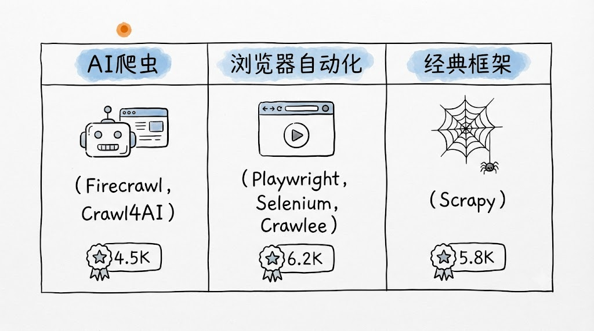
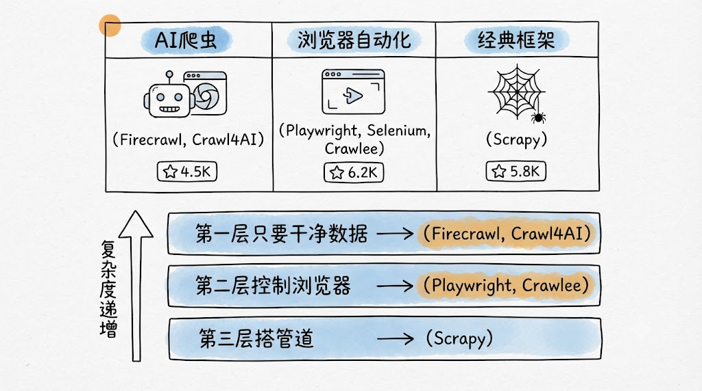

## 背景与触动

看到这篇文章的第一反应是很意外——很多人做数据抓取，第一反应是找付费 API，一问价格每月几百到几千美元，还得签合同。但 GitHub 上已经有人把工业级的爬虫工具开源了，能抗反爬、能处理百万页面，而且完全免费。

这个认知差很有意思。商业服务之所以能卖高价，核心在于「省事」——但当你知道有这些开源替代品存在后，花钱的理由就变薄了。

下面按照原文的分类框架，重新梳理学习笔记，加上自己的理解和思考。

## AI 时代首选：Firecrawl 和 Crawl4AI

### Firecrawl — 全场 Star 最高的爬虫项目

**基础信息：**

- GitHub：156,060 Star
- 地址：github.com/firecrawl/firecrawl
- 原仓库在 mendableai 名下，现已迁移到独立组织 firecrawl

**核心能力：**

- 指向任意网站，返回 Markdown 或结构化 JSON
- 自动处理 JS 渲染、反爬绕过、多页爬取
- 支持自托管或 API 调用

**学习笔记：**

这个工具的出现其实反映了一个大趋势——以前爬虫的目标是「把数据抓下来」，现在 AI 时代的目标变成了「把数据抓下来，并且让 AI 能直接读懂」。

传统的爬虫流程是：抓 HTML -> 清洗 HTML -> 解析 DOM -> 提取内容。但 Firecrawl 直接跳过了前两步——它输出的就是 Markdown 或结构化 JSON，AI 拿来就能用。对于做 RAG（检索增强生成）应用的人来说，这个价值非常大。

半个 AI 创业公司在暗用它的感觉很有意思——说明它已经被生产环境验证过了。

### Crawl4AI — 专为 LLM 和 Agent 设计的极速爬虫

**基础信息：**

- GitHub：75,012 Star
- 地址：github.com/unclecode/crawl4ai
- 无需 API 密钥、无需注册账户

**核心能力：**

- 专为 LLM 和 Agent 设计
- 极速爬取
- 开箱即用，无需认证

**学习笔记：**

据说 Crawl4AI 的诞生故事很有意思——一位开发者被 16 美元的付费爬虫服务激怒了，几天内就搞出了这个开源替代。

这个故事值得思考。当你对一个工具有强烈需求但被价格劝退时，开源往往是最优解——不是慈善，而是需求驱动。16 美元 rage-quit 出来的东西，能拿到 75k Star，说明确实解决了真问题。

两个工具对比：

| 维度     | Firecrawl      | Crawl4AI             |
| -------- | -------------- | -------------------- |
| Star 数  | 156k           | 75k                  |
| 自托管   | 支持           | 支持                 |
| API 密钥 | 需要（可选）   | 不需要               |
| 定位     | 企业级、结构化 | 轻量、快速、LLM 友好 |

**核心认知：** 这两个项目的共同价值在于——你不用再写复杂的解析逻辑，丢一个 URL 进去，拿到的就是 AI 能直接理解的结构化内容。这才是 AI 时代爬虫应该有的样子。

## 浏览器自动化老牌：Playwright、Selenium、Crawlee

### Playwright — 现代网页自动化的事实标准

**基础信息：**

- GitHub：93,463 Star
- 微软出品
- 支持 Chromium、Firefox、WebKit 三大引擎
- 覆盖 Python、Node.js、Java、C# 多语言

**学习笔记：**

Playwright 是微软出品的现代网页自动化工具，它解决了 Selenium 最大的痛点——不稳定。以前用 Selenium 写脚本，最烦的就是元素还没加载完就去操作，导致各种超时错误。Playwright 内置了自动等待机制，等元素真正可交互了才执行操作，脚本稳定性大幅提升。

三大引擎全覆盖是个关键特性。这意味着你可以用同一套代码在 Chromium、Firefox 和 WebKit 上测试，确保跨浏览器兼容性。

**思考：** Playwright 的定位很清晰——如果你要做一个新项目，需要浏览器自动化，选 Playwright 基本不会错。微软在维护，社区活跃，文档完善，多语言支持。

### Selenium — 老牌经典，胜在生态

**基础信息：**

- GitHub：34,323 Star
- 几乎所有编程语言都有 binding
- 大量遗留系统和测试框架仍依赖它

**学习笔记：**

Selenium 是老前辈了，生态最广，但确实比 Playwright 笨重。这里的「笨重」有两层意思：

1. 语法冗长，写起来没有 Playwright 简洁
2. 等待机制需要手动处理，不够智能

但它仍然是很多遗留系统的首选，原因很简单——习惯了，改造成本太高。大量企业的 CI/CD 流水线里跑的还是 Selenium，替换掉不是不可以，是没必要。

**思考：** 选 Selenium 还是 Playwright，取决于项目阶段。新项目直接 Playwright，老项目如果跑得好好的就别动了。

### Crawlee — 介于 Playwright 和 Scrapy 之间的甜点位

**基础信息：**

- GitHub：24,997 Star
- Apify 出品
- 把浏览器自动化和爬虫逻辑封装成简洁的 API

**学习笔记：**

Crawlee 的定位很有意思。它的作者觉得：

- Playwright 太底层，要写很多重复逻辑
- Scrapy 太重，学习曲线陡

于是 Crawlee 填补了中间地带——既有 Playwright 的现代感，又有 Scrapy 的爬虫思维（请求调度、去重、管道处理）。

**适用场景总结：**

- JS 动态渲染页面
- 需要登录态的页面
- 模拟真实用户交互的爬取任务

## 经典爬虫框架：Scrapy + 文档处理工具

### Scrapy — Python 爬虫框架的老大哥

**基础信息：**

- GitHub：63,411 Star
- 能处理百万页面的工业级爬虫管道
- 内置请求调度、去重、中间件、管道处理

**学习笔记：**

Scrapy 是 Python 爬虫领域绕不开的存在。它的架构设计很优雅：

- **请求调度器（Scheduler）**：管理请求队列，控制并发
- **下载器中间件（Downloader Middleware）**：处理请求/响应的拦截和修改
- **爬虫（Spider）**：定义如何解析页面和提取数据
- **管道（Pipeline）**：处理提取后的数据，如去重、存储

学习曲线确实陡，但一旦掌握，天花板极高。「能稳定处理百万级页面」——这是实打实的能力，不是宣传语。

**思考：** 为什么说 Scrapy 仍然是大规模爬取的首选？因为它的架构就是为大规模设计的。请求调度、去重、断点续传、分布式扩展——这些 Playwright 和 Crawl4AI 不会帮你做，也不是它们的目标。

### llmsherpa — 让 AI 读懂文档

**基础信息：**

- GitHub：1,746 Star
- 专门把 PDF、Word、网页转成 AI 友好的格式
- 保留表格和布局结构

**学习笔记：**

这个工具不走量，走质量。如果你的场景不是「爬网站」而是「让 AI 读懂文档」，llmsherpa 比 Firecrawl 更精准。

一个关键洞察：**爬虫和文档处理的本质区别**。爬虫处理的是动态网页——需要处理 JS、绕过反爬、提取半结构化数据。文档处理处理的是静态内容——PDF、Word、HTML 文件，重点是保留原始的表格和布局结构，让 AI 能理解上下文关系。

### 其他经典工具补充

- **BeautifulSoup4**：HTML 解析入门必备，适合小规模单页面爬取
- **Splash**：scrapinghub 出品的 JS 渲染服务，是 Scrapy 的老搭档

## 工具选择决策树

原文给出了一个很好的分层思路，按需求层次选择：

### 第一层：只要干净数据，不想写解析

**选 Firecrawl 或 Crawl4AI**

- 丢 URL 进去，拿结构化数据出来
- 适合做 RAG、喂给大模型
- AI 创业公司的首选

### 第二层：要控制浏览器行为，模拟真实用户

**选 Playwright（新项目）或 Selenium（老项目）**

- Crawlee 介于两者之间，想要简洁 API 选它
- JS 动态渲染页面、登录态、模拟交互

### 第三层：要搭大规模爬虫管道

**选 Scrapy**

- 唯一能稳定处理百万级页面的框架
- 配合 Splash 处理 JS 渲染

### 一个简单判断

| 场景          | 推荐组合             |
| ------------- | -------------------- |
| AI Agent 爬取 | Firecrawl / Crawl4AI |
| 传统数据采集  | Scrapy + Playwright  |
| 轻量快速验证  | Crawl4AI（无需配置） |
| 企业级大规模  | Scrapy + Splash      |
| 文档 AI 提取  | llmsherpa            |

## 个人思考与总结

### 认知差是最贵的

很多人愿意每月花几百到几千美元买付费爬虫 API，而 GitHub 上已经有完全免费且工业级的替代品。这个认知差本身就是成本。

**启示：** 遇到商业需求时，先问自己——GitHub 上有没有成熟的开源方案？很多工具已经被 thousands of companies 在生产环境验证过了。

### 工具没有最好，只有最适合

Firecrawl 很火，但它不是万能的。如果你要处理百万级页面，Scrapy 仍然是首选。Playwright 很现代，但 Selenium 的遗留生态不可忽视。

**启示：** 选工具要看场景，而不是看 Star 数。Star 数是社区活跃度的指标，不一定是你的场景的最佳选择。

### AI 时代重新定义了爬虫的目标

以前爬虫的目标是「抓数据」，现在多了一层「让 AI 能用数据」。Firecrawl 和 Crawl4AI 正是这个趋势的产物。

**启示：** 如果你在做 AI 应用，数据清洗和结构化的能力可能比爬取本身更重要。花 80% 的时间清洗数据的时代可能正在被改变。

### 开源的力量

一个 16 美元的 rage-quit 能产生 75k Star 的开源项目。需求驱动创新的力量远超商业营销。

**启示：** 当你对一个工具有强烈不满时，要么忍，要么自己造。这篇笔记里提到的很多工具，可能就是这样诞生的。

### 一句话总结

这 10 个开源仓库能替代每月几百到几千美元的商业爬虫服务。AI 时代选 Firecrawl 或 Crawl4AI，传统场景选 Scrapy + Playwright。与其花钱买 API，不如先看看 GitHub 上已经有什么。

---

> **引用信息**
>
> - 原文标题：10个GitHub仓库，免费爬取整个互联网
> - 原文链接：https://mp.weixin.qq.com/s/JQ9zKAl9iOfzaCrLHrncUw
> - 原文作者：kaillll
> - 公众号名称：Kail的AI工具箱
